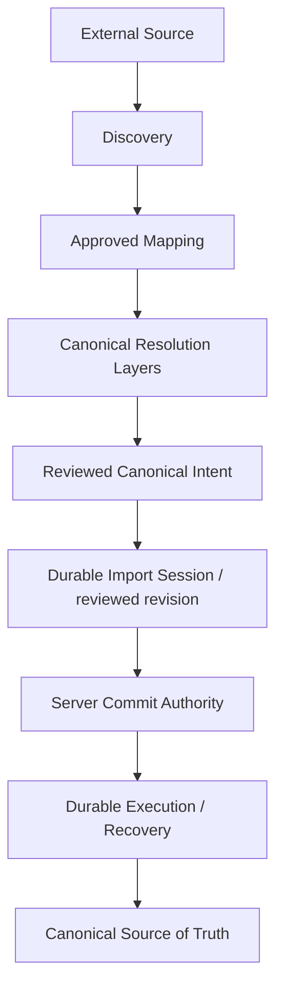
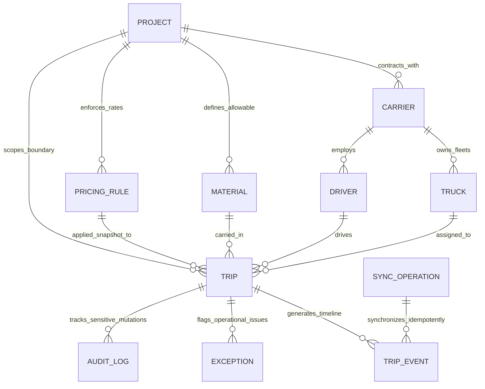

## Adaptive operational and Workspace architecture — current

Operational report projections now use OperationalReportTabRegistry, a reserved Ops namespace and sheet-scoped DOCUMENT ownership metadata. Creation atomically records marker/header; server mutations use verified numeric sheet IDs, and profile Script V2 checks the same markers. Legacy SABIL sheets and unmarked partial V1 tables remain untouched; canonical re-projection into new owned views replaces title-based adoption. Known Script upgrades reuse existing resources. Details and pending live acceptance are in [the operational contract](reconstruction/OPERATIONAL_PROFILES_WORKSPACE_ENGINE_CONTRACT.md).

Exact state is [the ledger](reconstruction/02_PHASE_LEDGER.md); semantics are [the operational contract](reconstruction/OPERATIONAL_PROFILES_WORKSPACE_ENGINE_CONTRACT.md).

Project business capabilities → OperationalProfileResolver → immutable Trip operational snapshot → current canonical Trip commands/identity/temporal/pricing authorities → durable metadata-only outbox → authenticated server canonical snapshot → profile-aware RAW Sheet projection and reporting. WorkspaceTemplateRegistry compiles four native profile blueprints and deterministic common/profile automation bundles. Independent Driver intake modes never fabricate identity; existing canonical Fleet onboarding remains authoritative. Measurements, derivations and estimates are separate facts.

Current delivery is USER_ACTIVE / REQUEST_DRIVEN. A throttled active-user hook sends one Firebase-only application-global coordinator request; no client Project list, Google token or business rows are accepted. Server grant-owned discovery proves canonical Project/subject/Spreadsheet/revision/principal and actual pending work before credentials. Automatic delivery uses pendingOnly drain and cannot repair workbooks or recover/install Script. Per-Project Google auth failures remain Project state; a completed global pass returns counters/HTTP 200. Pointer/keyboard triggers are retired. Explicit Project administration remains separate; CONNECTED durable grants refresh a server credential through the shared initialize/retry-sync/automation-recovery resolver before browser headers. Missing durable authorization permits an explicit fresh memory-only browser grant; identity/scope/refresh failures do not fall back. BROWSER_GOOGLE_TOKEN = EPHEMERAL / MEMORY_ONLY; CREDENTIAL_AUTHORITY = SERVER_REFRESH_WHEN_CONNECTED. SCHEDULED_BACKGROUND_WORKER is NOT_REQUIRED, CRON_JOB is NOT_DEPLOYED by owner decision. The scheduled worker remains dormant future capability; server refresh serves active user requests. No scheduler/offline secret configuration is a prerequisite for current acceptance. No automatic OAuth popup or identity/RBAC expansion.

Bounded provider classification is shared across Template/Blueprint/Drive/Sheets/Script/reports and refresh. Client decoding separates host/proxy availability from Google failures and never displays raw JSON/body errors. Failed sync preserves binding/pending evidence and releases its owned lease even if final audit fails; crash expiry remains authoritative. See [credential/provider contract](reconstruction/PROJECT_GOOGLE_SHEET_SYNC_CONTRACT.md).

The older complete-Workspace checkpoint below describes the previous deployment proposal; scheduled-worker requirements there are superseded by this decision. Binding-first repair and principal/lease/revision/provider fences remain current. Real Google profile/recovery acceptance is still external; no deployment is claimed.

## Complete Project Workspace integration

Exact current state: [phase ledger](reconstruction/02_PHASE_LEDGER.md). Firestore is the canonical data hub; the application commands Firestore; Sheets is the server projection/continuity surface; Apps Script is optional workbook-local automation.

Connect human Google account → choose folder once (or recover durable resource IDs) → verify Project/account/parent/tag/storage evidence → atomically persist binding/CONNECTED and dirty all master domains → inspect and safely repair the existing approved workbook → install/verify authorized automation independently → deliver fresh canonical Firestore snapshots through existing tab reconciliation/outbox. Operator inputs/review decisions are preserved. Different native sheet IDs are mapped by title; strict pristine-workbook verification is not binding authority. Uncertain Script creation cannot be retried blindly.

Independent binding, sync, structure and automation health remain visible. Binding survives provider failure; pending work survives failed/racing delivery. RAW, stable-key master writes reflect all participation states and canonical temporal relations without fabricated data or historical operational snapshot rewriting. The seven SABIL/HAIL operational tabs and reviewed Script source remain authoritative assets.

Server authorization-code flow binds PKCE/state/nonce to one current Firebase principal, Project and Google subject. Refresh credentials are AES-GCM encrypted in server-only documents, outside Project business data, and never returned to a browser. Revocation/replacement fences delivery transactionally. The standalone scheduled worker obtains transient access server-side and invokes the same Project authority/drain, using renewable expiring leases and per-HTTP-request owner checks/timeouts. No competing sync engine or client row authority is introduced.

Source implementation does not establish real Google acceptance. Hosting secrets, exact approved callback, owner consent, a scheduled worker and Q-PRJ-007 live checks remain external gates. See [the sync contract](reconstruction/PROJECT_GOOGLE_SHEET_SYNC_CONTRACT.md) and [deployment/authorization contract](reconstruction/GWS2_BACKGROUND_AUTHORIZATION_CONTRACT.md). No bidirectional master writes, Trip redesign or Phase 10 work.

## Historical GWS1B-LIVE-02 — initial destination versus migration


Current state defers to [the ledger](reconstruction/02_PHASE_LEDGER.md). Initial Project provisioning uses one explicit Picker-folder validator: local eligibleDestination registry checks, then one human-token Drive metadata read of that selected folder. Require valid ID, accessible/nontrashed folder MIME and canAddChildren===true; Shared Drive folders follow the same capability rule. Do not read unselected parents under drive.file. The migration-era validateDestinationFolder/assertProjectFolderResource ancestry proof remains unchanged for migration and bound-resource operations. Initial policy rejects selected current/foreign canonical IDs and foreign reservations; it is deliberately not a proof about every unselected ancestor. No OAuth/blueprint/Script or PWA redesign. See [the sync contract](reconstruction/PROJECT_GOOGLE_SHEET_SYNC_CONTRACT.md).

## GWS1B-LIVE-01 — client/server generation convergence

Current supporting architecture; [the ledger](reconstruction/02_PHASE_LEDGER.md) alone owns status. Vite compiles APP_BUILD_ID and emits runtime-build.json in the same dist artifact. The production server advertises that artifact's identity, never a later checkout SHA. Build identity derives from commit/deployment SHA; local dirty/restricted builds use a deterministic source suffix, no timestamp. A missing identity fails the build; missing runtime artifact fails closed.

GET /api/runtime-version is public, credential-free and no-store. Token-free startup/layer preparation checks server identity/Workspace contract; a recent confirmed snapshot preserves the synchronous OAuth click gesture. Each destination/provision request rechecks and carries X-App-Build; server route fences reject mismatches before Google access. Existing auth/Project/storage authorization remains intact. Known mismatch means APP_UPDATE_REQUIRED, unavailable version means APP_VERSION_UNAVAILABLE, not Drive failure.

Supported registerSW callbacks, Workbox skipWaiting/clientsClaim and a narrow importScripts hook converge controllers and pages. Modern tabs reload only after confirming the new controller; legacy unaware tabs can be navigated once after verified activation, without waiting for that navigation inside activate. No auth/outbox storage is cleared. Workbox keeps offline navigation fallback and cleans obsolete precache revisions; API navigation is excluded. HTML/worker/version responses revalidate or are no-store, hashed assets remain immutable. See [the continuity contract](reconstruction/PROJECT_GOOGLE_SHEET_SYNC_CONTRACT.md) for loop/race/offline limitations. No Google/blueprint redesign.

## Historical GWS1B — versioned Workspace generation (binding gate superseded by GWS2)

Historical implementation reference; current state defers to [the ledger](reconstruction/02_PHASE_LEDGER.md).

Isolated Google permission grant → destination-folder Picker → fresh server Project/account/scope/lifecycle authorization → immutable destination approval → tagged Project folder → new native spreadsheet → versioned blueprint construction → bound Apps Script project and exact content → structural/script validation → atomic durable binding → existing canonical-input outbox/manual drain. Human-user OAuth owns the resources; no hidden source workbook read/copy, service-account ownership, template Picker or Firebase reauthentication. Native Sheets MIME creation through Drive atomically includes parent and recovery tags. `drive.file`, `spreadsheets`, `script.projects` and basic identity are requested.

The owner-local sanitized SABIL-HAIL-V1 asset and nine reviewed Script sources are compiled into the server. Only simple onOpen/onEdit remain automatic; installable triggers, timers and Execution API are excluded. Static/report/validation skeletons are generated by Sheets requests, not remote installer calls. A single scoped edit dispatcher preserves review decisions and performs bounded audit/ledger/dashboard refreshes, with viewer-only edits isolated. Programmatic API writes do not fire simple triggers: unattended derived-report refresh after APP projection remains explicit debt, not a new worker. Actual Google runtime/30-second execution acceptance remains unverified. Existing outbox/manual delivery and canonical app authority are unchanged. See [the sync contract](reconstruction/PROJECT_GOOGLE_SHEET_SYNC_CONTRACT.md). No GWS2 or Phase 10 work.

## PFAG-RB2 coherent maintenance composition

Current architecture reference; exact acceptance state belongs to [the ledger](reconstruction/02_PHASE_LEDGER.md).

`Reusable maintenance editor → existing scoped server authority → version/validation/audit transaction → receipt → foundation-snapshot read transaction → cross-surface/expected-result proof → generation-fenced atomic apply → same workflow`.

ProjectFleetQueryService composes existing Master Data, Setup/Fleet, relationship, pricing-list and readiness readers in one transaction. No broad event/revision framework, independent-result stitching or alternate business authority is introduced. Wizard remains an orchestrator and reusable-capability host. Its Fleet child and pricing/readiness presentation consume the same composed payload; refresh-only retries cannot replay a successful command. A scoped dashboard readiness badge distinguishes ACTIVE status from current operational readiness without changing status.

Project maintenance is allowlisted; identity and historical-sensitive configuration remain protected. Suspension preserves graph/history; explicit reactivation reuses activation readiness. Global Driver/Truck profile edits reuse one service/editor; import architecture and reviewed-intent authority are unchanged. Existing contextual import creation remains a useful shortcut to canonical capabilities, not a duplicate business path.

## PFAG-RB1 authority and relationship safety

Current architecture reference; exact unit/acceptance state belongs to [the ledger](reconstruction/02_PHASE_LEDGER.md).

`Current server principal + Project scope → central Project lifecycle policy → canonical command → consequence reads/plan → atomic membership/temporal-slot/history/audit writes`.

No silent cascade. No dangling active dependency in the scoped membership consequence paths. Driver/Truck/Material transitions execute bounded safe temporal closures atomically; Carrier rejects with dependency evidence instead of arbitrary cascading. Existing temporal history and global identities remain intact. New allocation also checks the current canonical Carrier global status and membership through Truck affiliation. Cleanup retains parent-command authorization and never broadens roles.

Historical reports consume saved Trip snapshots, then saved legacy snapshot representations, then canonical IDs. Current master lookup cannot overwrite historical labels, capacity, Project print header or pricing. Missing historical capacity/tax facts remain unavailable. This does not implement H3 coherent refresh or broad maintenance UX; those remain PFAG-RB2 scope. Controlled in-memory transaction verification is not native Firestore certification.

# Current pricing authority — P9-U1 / P9-U2

Classification: CURRENT_ARCHITECTURE_REFERENCE. Exact phase/unit/publication state belongs only to [the ledger](reconstruction/02_PHASE_LEDGER.md).

`Wizard / field preview → authenticated pricing transport → ProjectPricingServerService → canonical participation + pricing_rules → shared PricingService selector/calculator → transactional Trip persistence`.

The single save action is server-decided: unused edit, status mutation or used-rule copy-on-write. Replacement writes predecessor cutoff metadata, a successor and correlated CREATE/UPDATE audit records atomically. Original commercial effective terms/rates remain preserved. Selection clips the predecessor's resolution window without rewriting its commercial terms; terminal snapshots never consult today's rule. A deactivated successor does not revive its predecessor.

PER_TON and PER_TRIP are production-supported. Quantity/minimum weight, tax rounding and stored terms are handled by the shared pricing policy. No new waiting accrual, adjustment approval, accounting or Trip lifecycle subsystem is activated. Unused old SettlementAdjustmentService/browser approval methods have no active product caller and remain outside the supported mutation surface. Read-only legacy aliases are normalized into the same policy; unsupported models fail closed. Live deployment is a separate acceptance gate.

# Current Smart Import architecture — bounded Phase 8 reference

Classification: CURRENT_ARCHITECTURE_REFERENCE for this section. Exact phase/unit status and accepted merges belong only to [the Phase Ledger](reconstruction/02_PHASE_LEDGER.md). This section describes merged B1–B3 and the B4 source/resume coordination; exact local acceptance and publication status is in the ledger.



The durable session begins at intake; the diagram's session step is publication of the reviewed revision, not deferred creation of the session. B1 checkpoints preserve stable Project/Session/Operation/Batch identities, source/mapping revisions and first-class reviewed intent. Local file bytes do not survive restart and must be reattached and verified. Immutable chunks are staged before a complete manifest becomes active. Trip and Roster contracts remain distinct.

The pre-Phase-8 Master Design Review led to SI-CG1 and SI-CG2 before B1. Grouping is based on natural/canonical identity; rejected rows are excluded; Material is not a universal roster prerequisite; internal and physical source rows are separate provenance. Natural identity outranks display-name/fuzzy evidence. Contextual Create, Enroll, Reactivate and Affiliation use existing Master Data authority and are distinct from PREPARED_NEW review plans. Identity creation never hides temporal changes.

B2's `ReviewedRosterCommitServer` loads the durable approved artifact, authorizes the current actor, revalidates the canonical state and calls shared identity/participation/temporal plan/write primitives. Raw labels do not choose execution targets. The old raw-row path and ordinary Roster checkpoint-to-COMMITTED path remain fenced.

Local B3's `RosterExecutionServer` adds a Project-scoped operation journal, deterministic consequence identities and immutable group plans. Independent dependency components may progress separately; coupled identities/relationships/displaced slots remain atomic through B2. A successful group commits canonical writes, receipts and operation/session versions together. Explicit retries replace a generation fence and skip receipted groups. Current satisfaction may reduce work; broader effects require renewed review. Cancellation linearizes at the transaction boundary and preserves completed effects. Status is read from durable records after response loss or restart.

Server limits still apply to each atomic group. A connected group exceeding B2 limits is rejected before its writes; B3 does not split an indivisible relationship invariant. Full receipts remain durable when a terminal summary is bounded; a truncated summary reports canonical refresh pending rather than claiming proof from incomplete data. Artifact staging interrupted before manifest publication leaves no executable operation claim. Local in-memory verification is not live-Firebase acceptance.

B4 makes the Wizard consume durable execution status before restoring managed Sessions. Local file reattach is exact and needed only before analysis. Google Sheets Roster supplies a different parser to the same Roster discovery/review pipeline; Trip retains its separate adapter. Terminal/partial/cancelled/review-required panels show journal evidence, and canonical refresh is independent from commit. Offline redesign, pricing and Trip lifecycle changes remain outside this implementation. No browser Firestore write authority is introduced. See [Data Model](DATA_MODEL.md), [API](API_CONTRACT.md) and [Security](SECURITY_MODEL.md) for the bounded current contracts.

## Historical original specification — preserved reference

> **HISTORICAL_RECORD — original design/reference specification.** The preserved body may combine implemented behavior with former targets; it is not proof of current routes, schemas, security, deployment or reconstruction status. Current GitHub main takes precedence. For the verified repository overview see [MASTER_PROJECT_HANDOFF.md](reconstruction/MASTER_PROJECT_HANDOFF.md); current state is [02_PHASE_LEDGER.md](reconstruction/02_PHASE_LEDGER.md). No historical target here authorizes product changes.

# Q Saudi Work Follow — النظام المعماري الشامل (Architecture Specification)

## 1. نبذة عامة والرؤية المعمارية (System Vision & Overview)

مشروع **Q Saudi Work Follow** هو منصة رقمية سحابية متقدمة (Full-Stack Multi-Project Logistics & Dispatch Management Platform) صُممت خصيصاً لإدارة عمليات النقل الثقيل وسلاسل إمداد المواد الإنشائية واللوجستية في المملكة العربية السعودية.

تم تصميم النظام ليعمل بكفاءة عالية في بيئات العمل الميدانية القاسية التي تتسم بضعف أو انقطاع شبكات الاتصال (Desert & Remote Sites)، مع الامتثال الصارم للضوابط التشغيلية والمحاسبية والتنظيمية (الهيئة العامة للنقل - منصة وصل/نقل، وهيئة الزكاة والضريبة والجمارك ZATCA).

---

## 2. المبادئ الإلزامية الصارمة (The 12 Invariant Architectural Principles)

تخضع جميع مكونات النظام بدون أي استثناء لـ 12 مبدأ معمارياً صارماً:

| # | المبدأ المعماري | الوصف والتطبيق الفني |
|---|---|---|
| **1** | **Firestore هو Source of Truth للعمليات** | قاعدة بيانات NoSQL الموزعة Firestore هي المصدر الأوحد والنهائي للحقيقة لكافة السجلات والعمليات اللوجستية والحالات والمقاييس. |
| **2** | **Google Sheets هو Operational/Reporting Projection** | جداول Google Sheets تعمل كإسقاط بياني (Read/Reporting Projection) لفرق العمليات ومسؤولي المتابعة بدون التأثير على صحة البيانات الأساسية. لا يُسمح للقراءة من الشيت لتعديل حالة النظام. |
| **3** | **Google Drive لتخزين ملفات المشروع والتقارير** | ملفات بوالص الشحن (Waybills)، وصور تذاكر الموازين (Weighbridge Slips)، ومستندات الفحص، وتقارير PDF الشهرية تُحفظ في مجلدات هرمية منظمة ومحمية على Google Drive. |
| **4** | **جميع Business Rules على Server-Side** | قواعد العمل، والتحقق من صحة الانتقال بين الحالات، وضوابط الحمولات، واحتساب الضرائب، تُنفذ حصرياً داخل خادم Node.js / Cloud Functions الآمن. |
| **5** | **Client لا يقرر Status النهائي** | العميل (Web/PWA) يرسل فقط "طلبات أحداث" (`Request Transition Event`). الخادم هو الكيان الوحيد المخول باعتماد التغيير وتحديث `trip.status`. |
| **6** | **Client لا يحسب القيمة المالية النهائية** | الحسابات المالية، والتعريفات، وغرامات التأخير (Demurrage)، وضريبة القيمة المضافة (15% VAT) تُحسب خادمياً بواسطة محرك التسعير (Server-Side Pricing Engine). |
| **7** | **Client لا يحدد Project Access** | صلاحيات المشاريع تُدار عبر Firebase Custom Claims و Security Rules الخادومية؛ لا يمكن للعميل تزوير أو تجاوز نطاق مشروعه المعتمد. |
| **8** | **لا توجد كلمات مرور أو API Secrets داخل Client** | مفاتيح Google Service Accounts، وأسرار التشفير، ومفاتيح API السرية موجودة حصراً في بيئة الخادم المشفرة (`process.env`). |
| **9** | **جميع عمليات الكتابة Idempotent** | كل طلب مزامنة أو تعديل يحمل `clientUUID` فريد و `idempotencyKey`، مما يضمن معالجة الطلب مرة واحدة بالضبط وتفادي التكرار عند إعادة المحاولة. |
| **10** | **النظام Multi-Project** | عزل كامل للبيانات والسجلات والمستندات على مستوى المشاريع (`tenant/project isolation`)، مع دعم مقاولين ناقلين متعددي المشاريع. |
| **11** | **النظام Offline-First** | واجهة PWA معتمدة على IndexedDB لتخزين البيانات المرجعية وقائمة الانتظار المحلية للعمليات (Local Mutation Queue)، مع مزامنة خلفية تلقائية فور توفر الشبكة. |
| **12** | **سجل تدقيق Audit Log لكل التغييرات الحساسة** | سجل غير قابل للتعديل (Immutable Append-Only Log) يوثق الفاعل، التوقيت، الفروقات (Diffs)، ورقم المعاملة لأي تعديل مالي أو تشغيلي أو استثناء. |

---

## 3. شرح العلاقات الشاملة بين كيانات النطاق (Core Domain Relationships)

يتمحور النظام حول العلاقات الوظيفية والبيانات الدقيقة بين 11 كياناً أساسياً:



### تفصيل العلاقات الوظيفية الدقيقة:

1. **المشروع (Project):**
   * يمثل الكيان الجذري التشغيلي والحدود المالية (Tenant Boundary).
   * يرتبط بعقود مع مقاولين ناقلين متعددين (**Carriers**).
   * يحدد المواد المسموح بنقلها (**Materials**) ونطاق الأسعار المعتمدة (**Pricing Rules**).
   * تتبع له جميع الرحلات (**Trips**) وسجلات التدقيق (**Audit Logs**) ومجلدات Google Drive المخصصة.

2. **الناقل / مقاول النقل (Carrier):**
   * شركة أو مؤسسة نقل معتمدة متعاقدة مع المشروع لنقل المواد.
   * يمتلك أسطولاً من الشاحنات (**Trucks**) ويوظف سائقين مؤهلين (**Drivers**).
   * ترتبط به قواعد تسعير تعاقدية معينة قد تختلف من ناقل لآخر بناءً على شروط العقد.

3. **قاعدة التسعير (Pricing Rule):**
   * مصفوفة خادومية تحدد كيفية تسعير الحمولة:
     * سعر الطن (Per Ton).
     * سعر الرد / المشوار (Per Trip).
     * سعر الكيلومتر (Per Km).
     * أجور الانتظار والتأخير (Demurrage Rates).
   * ترتبط بالمشروع والمادة ونوع الشاحنة، وتُؤخذ منها لقطة تاريخية (`Pricing Snapshot`) في لحظة اعتماد الرحلة لضمان ثبات القيمة المالية حتى لو تغيرت القاعدة مستقبلاً.

4. **المادة (Material):**
   * المادة المنقولة (مثل: كتل صخرية، رمل ناعم، بيس كورس Base Course، أسفلت، بحص Aggregates).
   * تحدد الكثافة القياسية، والحد الأقصى للرطوبة، ونوع الشاحنة المطابق لنقلها.
   * ترتبط مباشرة بالرحلة (**Trip**) لتحديد الموازين وقواعد الفحص والتسعير.

5. **الشاحنة (Truck):**
   * المركبة المادية التابعة للناقل (قلاب، تريلا، سطحة، بوري)، موثقة برقم اللوحة ورقم الهيكل.
   * مسجلة بوزنها الفارغ المعتمد رسميًا (**Tare Weight**) وحمولتها القانونية القصوى (**Max Legal Payload**).
   * يتم التحقق منها خادومياً قبل إطلاق أي رحلة لضمان سريان الفحص الدوري ووثيقة التأمين ورخصة السير.

6. **السائق (Driver):**
   * السائق المعتمد التابع للناقل والمخول بقيادة الشاحنة.
   * موثق برقم الهوية الوطنية أو الإقامة ورقم رخصة القيادة ورقم الجوال.
   * يرتبط بجلسة تطبيق PWA في الميدان لتسجيل الأحداث التشغيلية والتقاط صور التذاكر.

7. **الرحلة (Trip):**
   * الوحدة التشغيلية والمحاسبية الأساسية في النظام.
   * تجمع في نقطة زمنية ومكانية محددة: **المشروع + الناقل + الشاحنة + السائق + المادة + قاعدة التسعير**.
   * تمر بدورة حياة صارمة (State Machine) من الإنشاء إلى الإتمام المعتمد.

8. **أحداث الرحلة (Trip Event):**
   * تدفق زمني غير قابل للتعديل (Append-Only Event Stream) يوثق كل مرحلة للرحلة:
     * `DISPATCHED` -> `ARRIVED_LOADING` -> `WEIGHBRIDGE_IN` -> `LOADED` -> `EN_ROUTE` -> `ARRIVED_SITE` -> `WEIGHBRIDGE_OUT` -> `OFFLOADED` -> `COMPLETED`.
   * يتضمن الطابع الزمني الموثوق (Server Timestamp)، إحداثيات GPS، هوية المستخدم المُسجل، وبيانات الميزان (وزن إجمالي Gross، وزن فارغ Tare، وزن صافي Net).

9. **الاستثناء التشغيلي (Exception):**
   * حالة خلل أو انحراف عن المسار القياسي تتطلب تدخلاً إدارياً:
     * زيادة الوزن القانوني (Overload Exception).
     * اختلاف المادة عند الوصول (Material Mismatch).
     * عطل شاحنة في الطريق (Breakdown Exception).
     * تجاوز وقت الرحلة المسموح (Demurrage / Delay).
   * يوقف اكتمال الرحلة حتى يتم اعتماد حل رسمي أو تسوية من قِبل المشرف الميداني المعتمد.

10. **سجل التدقيق (Audit Log):**
    * السجل الأمني والمحاسبي غير القابل للحذف أو التعديل (Tamper-evident Audit Ledger).
    * يسجل أي تغيير على البيانات الحساسة (تعديل ميزان، تجاوز استثناء، تحديث قاعدة تسعير، إعادة احتساب مالي، أو تعيين صلاحيات).

11. **عملية المزامنة (Sync Operation):**
    * الحاوية الذاتية (Idempotent Sync Envelope) التي تضمن وصول وتطبيق العمليات التي تمت في وضع عدم الاتصال (Offline).
    * تحمل معرّف المعاملة الفريد، والبيانات الميدانية، وتدير إعادة المحاولة والتأكد من مطابقة السجلات خادومياً دون ازدواجية.

---

## 4. المخطط المعماري للطبقات (Architectural Tiers & Topology)

```
+-----------------------------------------------------------------------------------+
|                           CLIENT TIER (PWA & Field Apps)                          |
|  - React 19 + TypeScript + Tailwind CSS                                           |
|  - Service Worker (Offline Caching & App Shell)                                   |
|  - IndexedDB (Master Local Replica, Mutation Queue, Pending Events)               |
|  - Sync Manager (Background Sync Engine with Idempotency UUIDs)                   |
+-----------------------------------------------------------------------------------+
                                         │
                 HTTPS / REST / WebSocket (Authorized with Bearer Token)
                                         ▼
+-----------------------------------------------------------------------------------+
|                        AUTHORITATIVE BACKEND TIER (Node.js)                       |
|  - Node.js + Express + TypeScript Core Engine                                     |
|  - Firebase Admin SDK (Auth Token Verification & Claims Enforcement)              |
|  - State Transition Engine (Deterministic FSM validating Trip status)             |
|  - Server-Side Pricing Engine (SAR calculations, 15% VAT, Demurrage)              |
|  - Multi-Project Context Middleware (Tenant isolation & verification)             |
|  - Idempotency & Conflict Resolution Interceptor                                  |
|  - Audit Log Collector (Immutable trail logging)                                  |
+-----------------------------------------------------------------------------------+
                     │                                     │
                     ▼                                     ▼
+------------------------------------+   +-----------------------------------------+
| PRIMARY SOURCE OF TRUTH (Database) |   | PROJECTION & ASSET SERVICES (Async/Queue)|
|  - Google Cloud Firestore (KSA DC) |   |  - Google Sheets API (Reporting Proj.)  |
|  - Multi-Tenant Collections        |   |  - Google Drive API (Folder Hierarchy)  |
|  - ACID Batched Writes & Runs      |   |  - ZATCA Compliant Archival Worker      |
+------------------------------------+   +-----------------------------------------+
```

---

## 5. هيكلية التدفق البياني للبيانات (Data Flow Sequences)

### 5.1 دورة حياة تسجيل الرحلة وتأكيد الوصول (Dispatch to Completion):

1. **الطلب الميداني:** السائق أو مشرف الميزان يضغط "تسجيل وزن الانطلاق".
2. **المعالجة المحلية:** يُخزن الحدث في IndexedDB مع توليد `idempotencyKey = uuidv4()`.
3. **الإرسال الخادومي:** ترسل الحزمة إلى الخادم مصحوبة برمز التعريف `Bearer <Firebase_ID_Token>`.
4. **التحقق الخادومي:**
   - فحص صحة المستخدم وصلاحيته بالمشروع (`X-Project-Id`).
   - فحص عدم تكرار `idempotencyKey` في `sync_operations`.
   - فحص مطابقة قواعد الحالة السابقة مع الحالة الجديدة.
5. **الالتزام في الحقيقة (Source of Truth):**
   - تنفيذ Firestore Transaction لتسجيل `TripEvent`، تحديث `Trip`، وتحديث سجل التدقيق.
6. **الإسقاط غير المتزامن (Asynchronous Projections):**
   - تشغيل Worker لإضافة سطر في Google Sheet الخاص بالمشروع.
   - رفع صورة تذكرة الميزان إلى مجلد Google Drive المرتبط بالمشروع وتخزين المعرف `driveFileId`.
7. **إشعار العميل:** إرجاع الاستجابة المكتملة إلى تطبيق PWA لتحديث IndexedDB بحالة `SYNCED`.
