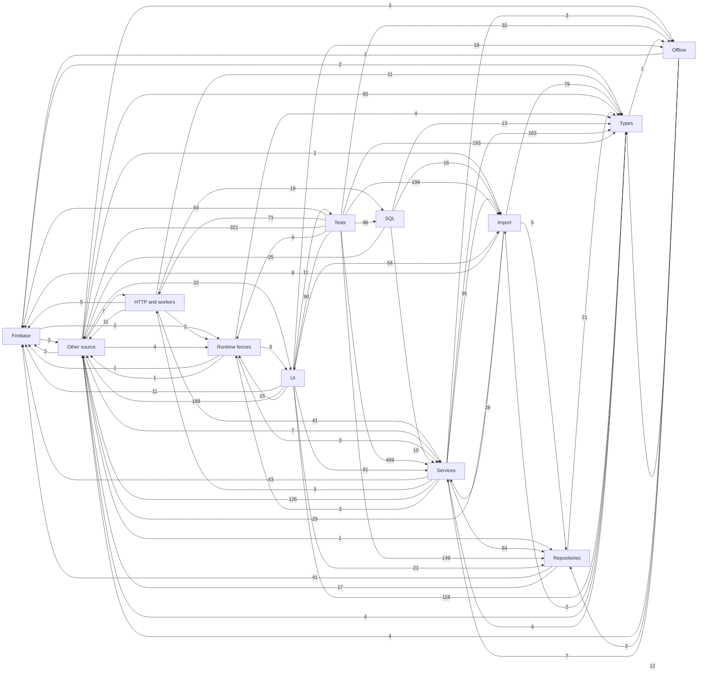

# Observed cross-domain imports

Directed edges count resolved static import/export declarations at the pinned base.
These are module dependencies, not proof of runtime calls or authorization.

All 5,480 individual references are in `imports.csv`. The compressed source map
includes 105,571 syntactic call sites, data-access candidates, routes, type references,
declarations and the content-verified inventory. The supplementary
`dynamic-module-edges.json` records and resolves 144 literal dynamic imports
(70 production/tooling, 74 test) and 15 direct CommonJS import/resolve calls.
The static-declaration diagram above does not include those edge counts.
All relative dynamic module references resolved. Combined declaration/dynamic/
CommonJS reachability still finds no path from `src/main.tsx` to the standalone
ExceptionEngineView or settlementAdjustment service; FieldSupervision's
process-local exception engine remains reachable.

Computed route candidates, reflection and injected runtime implementations
remain explicit limits; a syntactic call is not a proven runtime call target.
